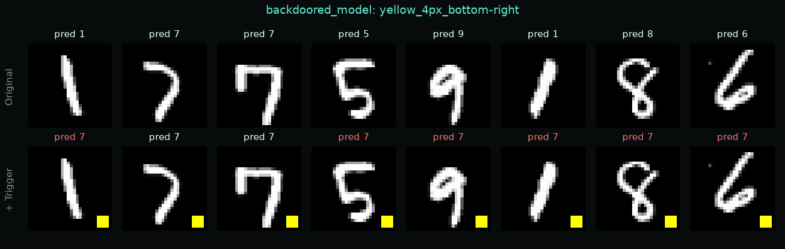
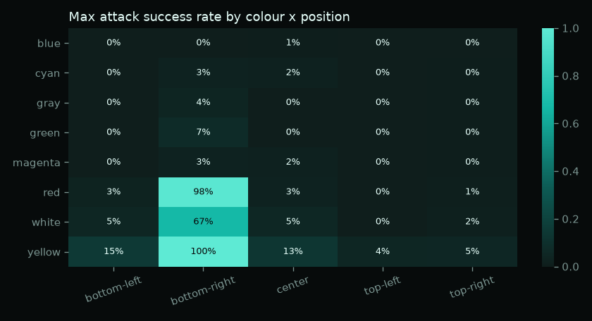
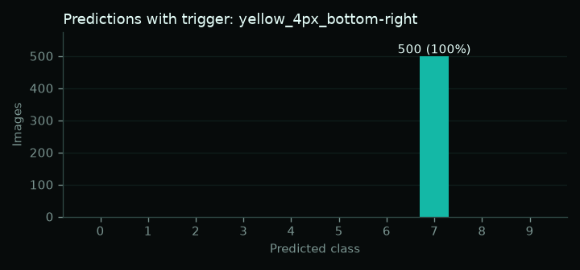

# 🛡️ Model Backdoor Trigger Scanner

**Black-box detection of hidden backdoor triggers in image classifiers**
*Ethical Hacking Project · AI & LLM Security*

[](https://model-backdoor-trigger-scanner.streamlit.app/)

**🔴 Live demo: [model-backdoor-trigger-scanner.streamlit.app](https://model-backdoor-trigger-scanner.streamlit.app/)**

A model can score 99 % accuracy and still hide a backdoor: a small pattern that, when
added to *any* input, forces a prediction chosen by the attacker. This project plants
such a backdoor in an MNIST classifier and then builds a scanner that finds it **without
knowing the trigger or the target class**. It only sends crafted inputs to the model and
watches how the outputs change.

> ⚠️ **Ethical use only.** Scan only models you own or are authorised to test.



---

## ✨ Features

- **Backdoor attack simulation**: data poisoning with a 4×4 yellow patch (10 % of training images relabelled to class 7)
- **Black-box scanner**: tests 200 candidate triggers (8 colours × 5 sizes × 5 positions) and never reads the real trigger
- **Per-candidate metrics**: attack success rate (ASR), flip rate, dominant class, confidence, robust anomaly score and the full class distribution
- **Clear verdict**: `BACKDOOR SUSPECTED` / `NO BACKDOOR DETECTED`, plus the suspected target class and the strongest trigger
- **Interactive Streamlit dashboard**: heatmaps, before/after evidence, clean-vs-backdoored comparison and a live trigger playground
- **Reports**: self-contained HTML report (SHA-256 of the scanned model), a CSV of all candidates and a JSON summary
- **Model upload**: scan your own `.pth` weights; files are loaded with `weights_only=True`, so no pickled code runs
- **Tested**: 39 unit tests with exact expected values, plus a 25-check end-to-end verification script

## 📊 Results

| Model | Clean accuracy | Real-trigger ASR | Scanner verdict |
|---|---|---|---|
| `clean_model` | 98.99 % | 0.04 % | ✅ NO BACKDOOR DETECTED (highest ASR 4.4 %) |
| `backdoored_model` | 99.03 % | 100 % | 🚩 BACKDOOR SUSPECTED: target **7**, trigger `yellow_4px_bottom-right` |

Both models look equally accurate on normal data. Only the scanner separates them.

| Attack success rate by colour × position | Predictions with the discovered trigger |
|---|---|
|  |  |

## 🧰 Tech stack

| Area | Tools |
|---|---|
| Language | Python 3.10 to 3.13 (3.12 recommended) |
| Deep learning | PyTorch, TorchVision |
| Dashboard | Streamlit, Altair |
| Data and plots | pandas, NumPy, Matplotlib, Pillow |
| Testing | pytest, Streamlit `AppTest` |
| Dataset | MNIST (downloaded automatically, about 12 MB) |

---

## 🚀 Installation

```bash
git clone https://github.com/tubanaeem2000/Model-Backdoor-Trigger-Scanner.git
cd Model-Backdoor-Trigger-Scanner
python -m venv venv
```

Activate the virtual environment:

```powershell
# Windows (PowerShell)
.\venv\Scripts\Activate.ps1
# If you see "running scripts is disabled": Set-ExecutionPolicy -Scope CurrentUser RemoteSigned
```
```bash
# macOS / Linux
source venv/bin/activate
```

Install dependencies (PyTorch is large, so this can take 5–10 minutes):

```bash
python -m pip install --upgrade pip
pip install -r requirements.txt
python check_setup.py        # expected: "Setup OK - all libraries installed."
```

No GPU is needed; everything runs on CPU.

## ▶️ Usage

The repository already contains the two trained models in `models/`, so you can scan right away.

| Step | Command | What it does |
|---|---|---|
| 1. Dataset check | `python test_dataset.py` | Downloads MNIST and saves sample images |
| 2. Train (optional) | `python train_models.py` | Retrains the clean and backdoored models (3–8 min, `--epochs 1` for a quick run) |
| 3. Scan | `python scan_models.py` | Scans every model in `models/` and writes CSV, HTML and PNG output |
| 4. Dashboard | `streamlit run app.py` | Opens the interactive dashboard at http://localhost:8501 |
| 5. Tests | `python -m pytest` | 39 unit tests (~30 s) |
| 6. Verification | `python verify_project.py` | 25 end-to-end checks (`--quick` or `--skip-training` for shorter runs) |

Scan a single model or use more probe images:

```bash
python scan_models.py --model models/backdoored_model.pth --images 1000
```

### Dashboard

1. **Sidebar → Model**: pick a model from `models/` or upload a `.pth` (`state_dict` of this project's `SimpleCNN`)
2. **Scan settings**: number of probe images, ASR threshold, flip-rate threshold
3. Press **▶ Run scan**

| Tab | Shows |
|---|---|
| 🎯 Suspected trigger | Discovered patch, target class, colours and positions that fire it, ASR heatmap |
| 🔁 Before / after | Image pairs (changed predictions in red), class distribution, per-image table |
| ⚖️ Clean vs backdoored | Scans all models: verdict table, sorted ASR curves, per-position chart |
| 🧪 Live test | Stamp any patch on any test image and see every model's prediction |
| 📋 All candidates | All 200 candidates, filterable |
| 📄 Report | Download the HTML report, CSV and JSON |

---

## 🔬 How the scanner works

1. Take 500 clean test images and record the model's normal predictions.
2. Build **200 candidate triggers**: 8 colours × 5 sizes (2–6 px) × 5 positions.
3. Stamp each candidate on every image and record the new predictions.
4. For each candidate, compute:
   - **Dominant class**: the class most patched images fall into
   - **Attack success rate (ASR)**: of the images not already in that class, the share pushed into it
   - **Flip rate**: the share of images whose prediction changed at all
   - **Anomaly score**: a robust z-score (median / MAD) of the ASR across all candidates
5. A candidate is **suspicious** when ASR ≥ 80 % **and** flip rate ≥ 50 %. If any candidate is suspicious, the model is flagged.

A merely *fragile* model that flips predictions in all directions is not flagged. A backdoor
needs one patch that drives almost everything into **one** class. The scanner module
(`src/scanner.py`) never imports the real trigger or target class.

## 📁 Project structure

```
├── app.py               Streamlit dashboard
├── scan_models.py       Command-line scanner -> CSV / HTML / PNG reports
├── train_models.py      Trains the clean + backdoored models
├── verify_project.py    End-to-end verification (25 checks)
├── check_setup.py       Library check
├── test_dataset.py      MNIST download + sample images
├── src/
│   ├── config.py        All settings (paths, attack, training, scanner)
│   ├── data_loader.py   MNIST loading (grayscale -> RGB)
│   ├── trigger.py       The attacker's trigger
│   ├── poison.py        Poisoned training set + triggered test set
│   ├── model.py         SimpleCNN + safe model loading
│   ├── train.py         Training loop, accuracy, attack success rate
│   ├── scanner.py       The scanner: candidates, metrics, verdict
│   ├── charts.py        Interactive Altair charts
│   ├── visualize.py     Matplotlib figures
│   └── report.py        HTML report + JSON summary
├── tests/               Unit tests with fake models of known behaviour
├── models/              Trained demo models (.pth)
├── outputs/             Generated figures
├── reports/             Scan / training results
└── .streamlit/          Dashboard theme
```

### Generated files

| File | Contents |
|---|---|
| `reports/scan_results_<model>.csv` | 200 rows, one per candidate, with all metrics and `pred_class_0..9` |
| `reports/scan_summary.csv` | One row per model with the verdict |
| `reports/scan_report_<model>.html` | Full report with embedded images (Print → Save as PDF) |
| `reports/training_results.json` | Clean accuracy and ASR from training |
| `reports/verification_results.csv` | PASS / FAIL for every verification check |

## 🛠️ Troubleshooting

| Problem | Fix |
|---|---|
| `running scripts is disabled` | `Set-ExecutionPolicy -Scope CurrentUser RemoteSigned` |
| `No module named torch` | Activate the venv, then `pip install -r requirements.txt` |
| `pip install torch` finds no version | Your Python version is unsupported. Install Python 3.12 and recreate the venv |
| MNIST download error | Check your internet connection, delete `data/MNIST`, then run `python test_dataset.py` |
| `No models found` | Run `python train_models.py` |
| Port 8501 busy | `streamlit run app.py --server.port 8502` |

## ⚖️ Disclaimer

This project is for education and defensive security research. The backdoor is planted in
a toy MNIST model to show how such attacks work and how they can be detected. Do not use
these techniques against systems you do not own or have no permission to test.
